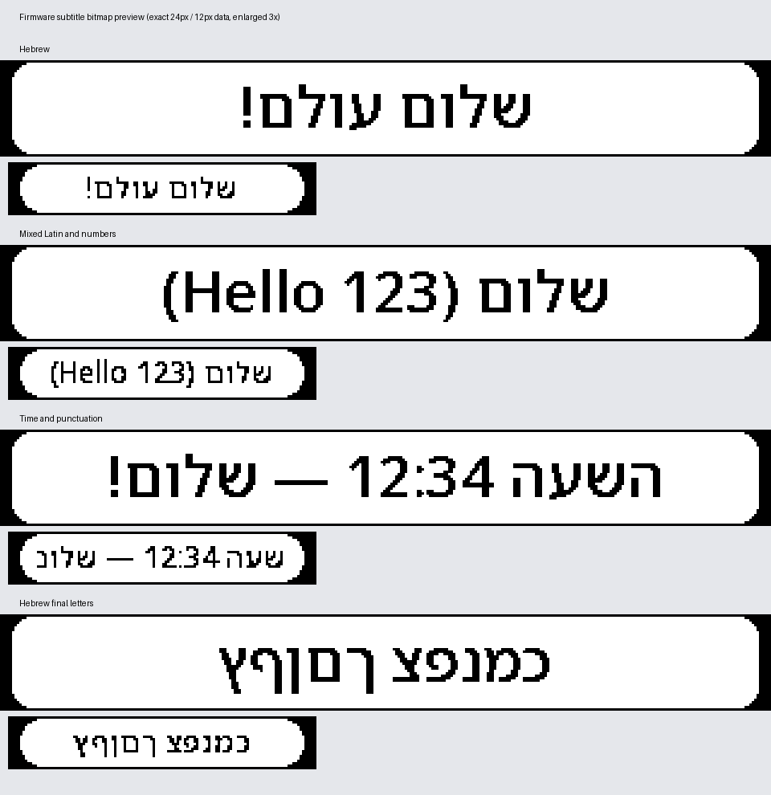

# M5Stack CoreS3 — עוזר קולי בעברית

מאגר העבודה והתיעוד לעוזר האישי: שיחה בעברית, פנים, מגע, כתוביות וחיפוש באינטרנט.
הבסיס הוא [stackchan-idf v0.14.3](https://github.com/ciniml/stackchan-idf/tree/v0.14.3),
קוד פתוח עם הרחבות מקומיות. המודלים עצמם פועלים בשירותי ענן.

**מצב נוכחי:** שיחה בעברית וקטיעה במגע כבר אומתו על המכשיר.
קושחת Relay עם הכתוביות העבריות נצרבה למכשיר והצליחה להשמיע תשובות מהשרת.
המסלול כעת הוא Groq לתמלול ולשיחה, Tavily לחיפוש ו־Google להפקת קול בעברית.
השרת דורש סוד מכשיר ומגבלות שימוש עמידות ב־Firestore. בדיקת ענן מלאה החזירה תשובה עם ארבעה מקורות.
אישור המשתמש לתצוגה, לחיפוש ולקטיעה בגרסה החדשה עדיין ממתין; הודעת הסיום טרם הופעלה.

חיווי מצב בעברית נוסף למסך: מאזין, שומע אותך, חושב ומדבר, ואישור קצר לנגיעה.
לשאלת שער דולר נשלף כעת שער יציג ישירות מבנק ישראל עם תאריך הפרסום.
זיכרון שיחה והזרמת קול עדיין אינם ממומשים.

## התמצאות

- [מצב העבודה ומה נשאר](docs/STATUS.md)
- [סקירת הארכיטקטורה וההמלצות](docs/ARCHITECTURE_REVIEW.md)
- [מסמך התכנון המקורי שנמסר — ייחוס, לא מימוש מאומת](docs/reference/VOICE_ASSISTANT_DESIGN.md)
- [הקוד המלא והבדיקות](firmware/stackchan-idf/)
- [בנייה, קובץ ניסיוני ושחזור](docs/BUILD_AND_RECOVERY.md)
- [תיעוד הבדיקות שבוצעו ומגבלותיהן](docs/VALIDATION.md)
- [העברת עבודה להמשך](docs/SESSION_HANDOFF.md)
- [השרת, חוזה ה־API וההפעלה](server/README.md)
- [סקירה עצמאית ובדיקות GitHub](docs/INDEPENDENT_REVIEW.md)
- [תשתית הענן, עלויות והזנת המפתחות בהמשך](docs/CLOUD_DEPLOYMENT.md)
- [קובץ אפליקציה ניסיוני ופרטי הבנייה](artifacts/manifest.json)
- [קושחת Relay שנצרבה — פרטי גרסה וגיבוב](artifacts/cores3-relay-2026-11-21.json)

## עקרונות

לשמר את התכונות שכבר עובדות במכשיר, להוסיף שרת מתווך שמאפשר החלפת ספקים בלי צריבה,
ולאמת שיחה, עברית, קטיעה וחיפוש על המכשיר לפני הכרזת סיום.
מפתחות, הגדרות רשת, לוגים גולמיים וגיבויי Flash/NVS פרטיים אינם נכללים במאגר הציבורי.

## רישיונות וייחוס

רישיון הקושחה נשמר ב־[LICENSE המקורי](firmware/stackchan-idf/LICENSE).
תלויות צד שלישי נשארות תחת רישיונותיהן; ראו [מקור הקוד](firmware/stackchan-idf/UPSTREAM.md).
